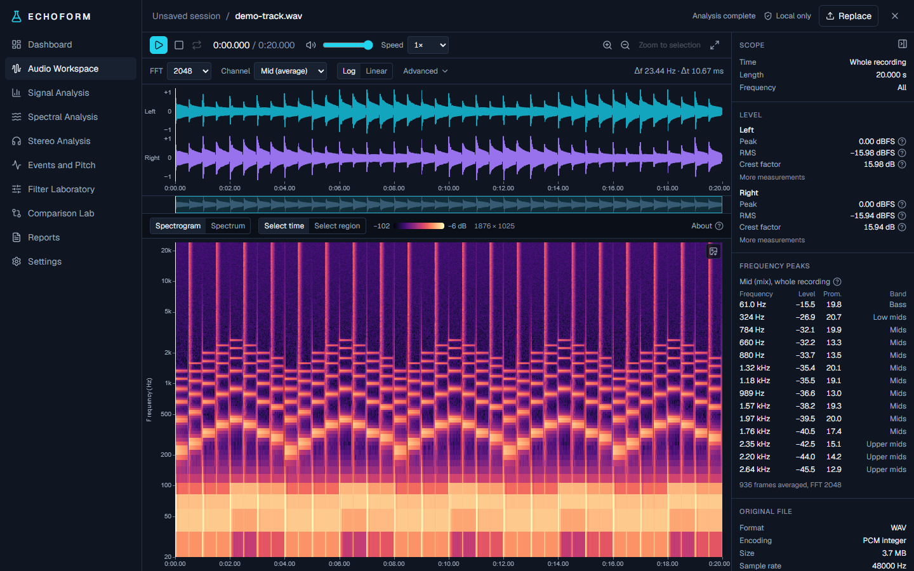
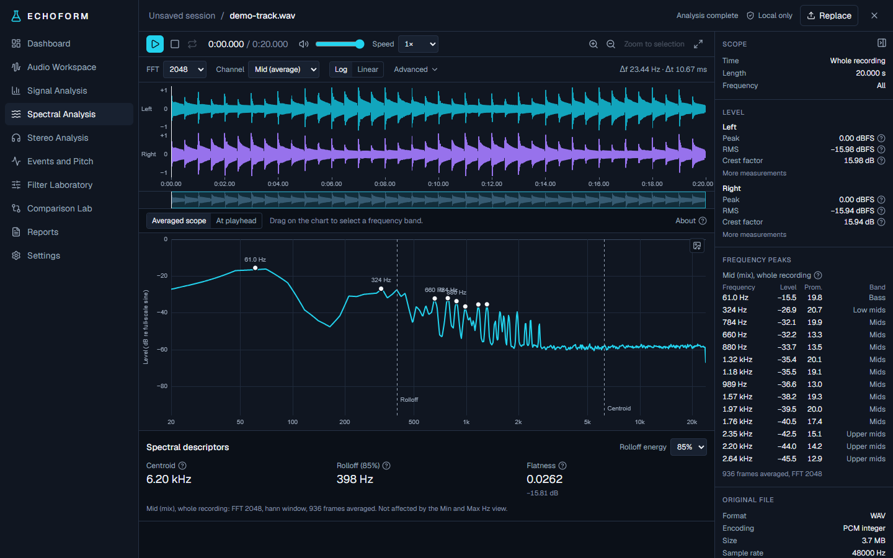
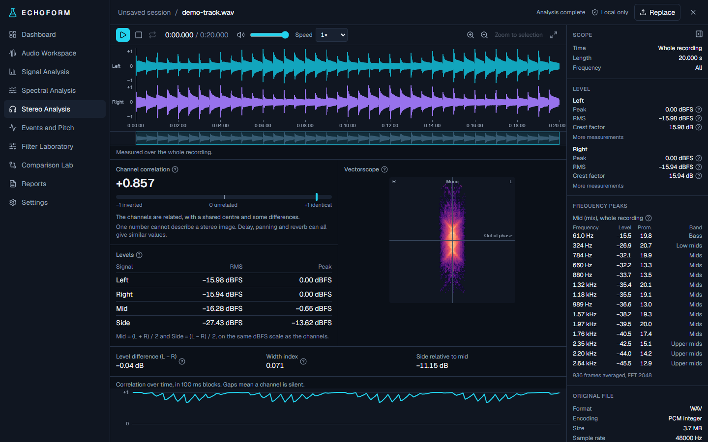
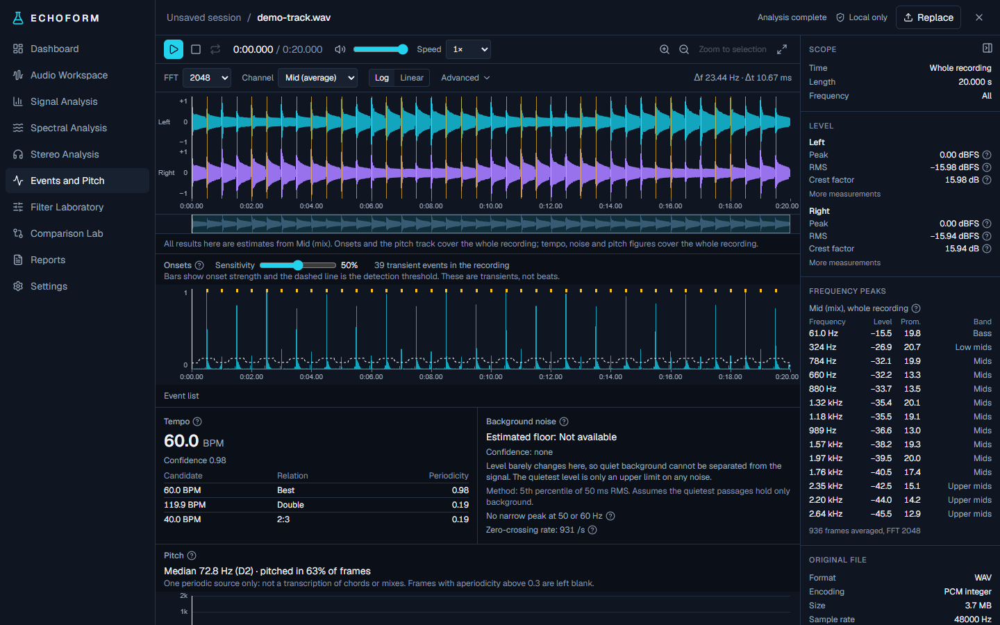
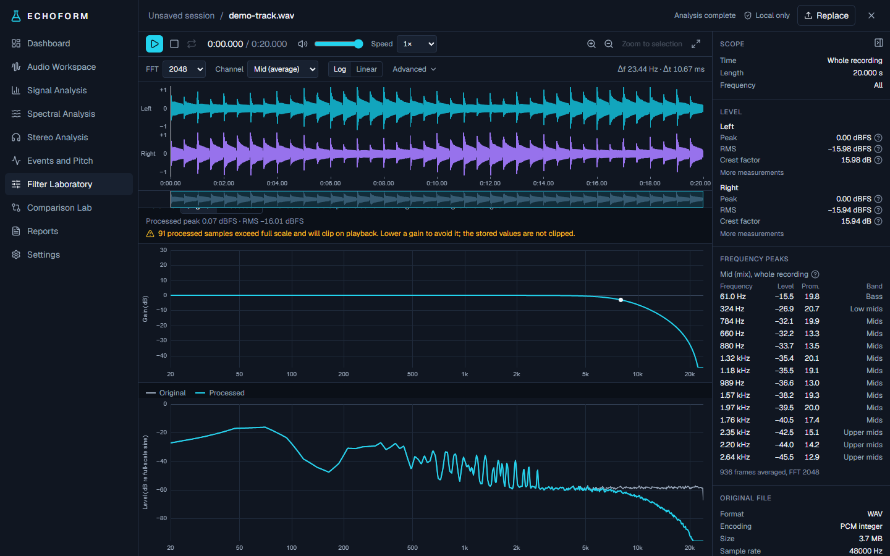
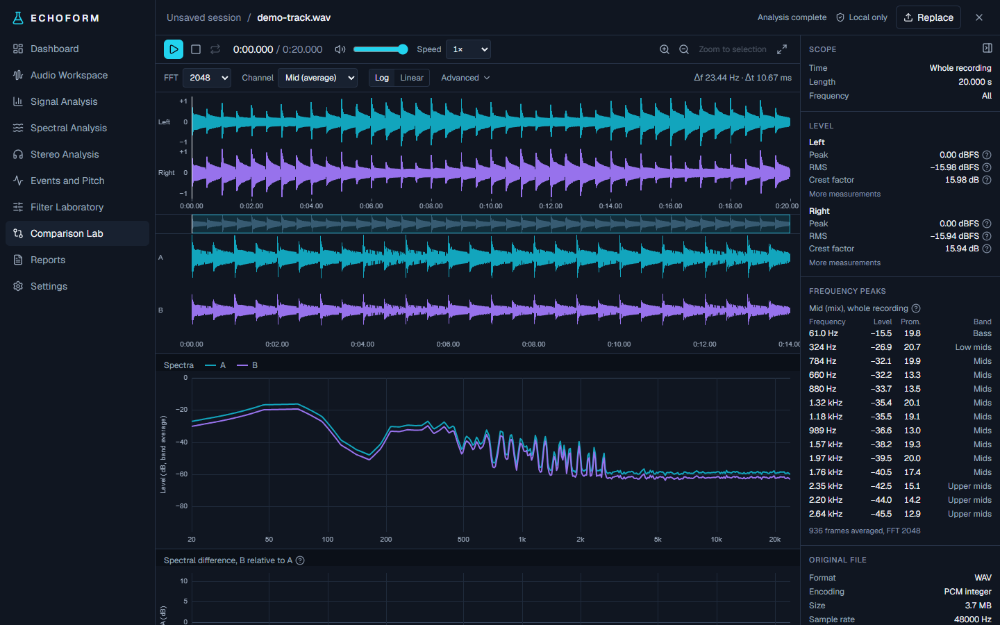
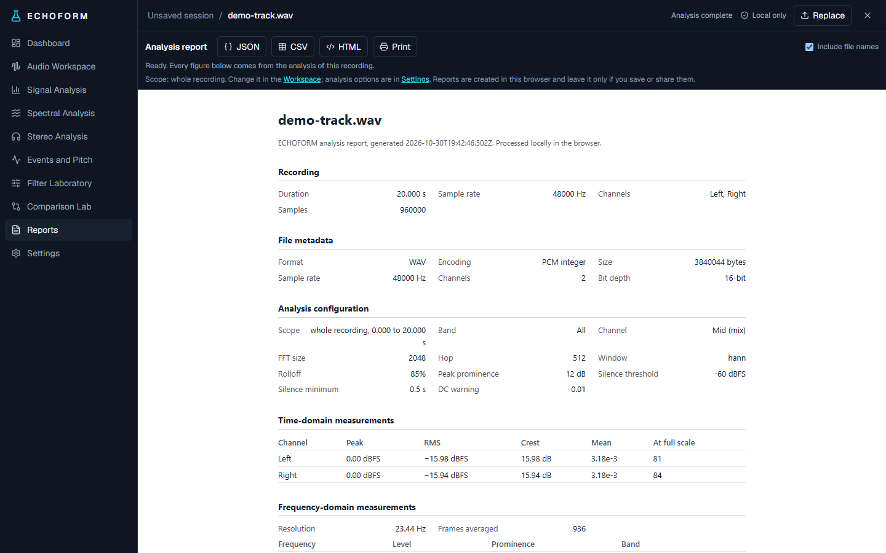
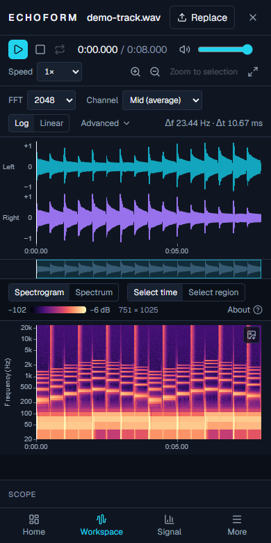
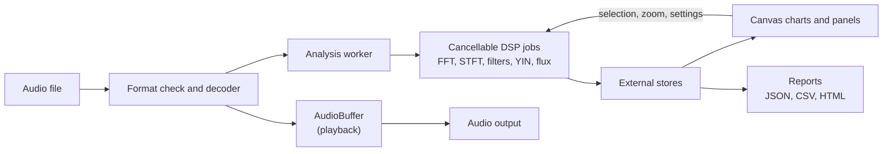

<p align="center">
  
</p>

<p align="center">
  <strong>An interactive audio analysis laboratory that runs entirely in your browser.</strong><br>
  Open a recording and measure it: no upload, no account, no server doing the work.
</p>

<p align="center">
  
  
  
  
  
  
  <a href="LICENSE"></a>
</p>

<p align="center">
  <a href="#features">Features</a> ·
  <a href="#gallery">Gallery</a> ·
  <a href="#quick-start">Quick start</a> ·
  <a href="#how-it-works">How it works</a> ·
  <a href="#scientific-validation">Validation</a> ·
  <a href="#limitations">Limitations</a> ·
  <a href="docs/TECHNICAL.md">Technical reference</a>
</p>

<p align="center">
  
</p>

## Not an audio player with charts

ECHOFORM treats a recording as something to investigate. Every number comes from the decoded
samples, every algorithm is tested against signals with known answers, and every estimate says how
it was made and when it should not be trusted. If a recording cannot support a measurement, the app
says so instead of showing a plausible figure.

- **Honest by design:** no simulated charts, and undefined values stay undefined, never zero
- **Private by default:** audio is decoded and analysed in your browser tab and never uploaded
- **Built for long files:** analysis runs in a cancellable worker, so the page stays responsive
- **Non-destructive:** filters render into a separate buffer and the original is never changed

## Features

| | |
|---|---|
| **Waveform** | Multiresolution rendering, from whole recording down to individual samples |
| **Spectrum** | Calibrated FFT with 7 sizes and 4 windows, averaged or live at the playhead, with peak detection |
| **Spectrogram** | Time-frequency regions, band zoom, PNG export, and detail recomputed as you zoom |
| **Signal analysis** | Level timeline, histograms, silence regions, clipping intervals and DC offset |
| **Spectral descriptors** | Centroid, rolloff and flatness for any time selection or frequency band |
| **Stereo analysis** | Correlation over time, mid and side levels, a width index and a vectorscope |
| **Filter Laboratory** | 7 filter types in a chain, exact response curves, and original versus processed listening |
| **Comparison Lab** | Two recordings with explicit alignment, normalisation, and spectral and waveform differences |
| **Events and pitch** | Onsets, tempo with alternatives, a pitch track, harmonics and harmonic-to-noise ratio |
| **Noise analysis** | Estimated floor and SNR with method and confidence, plus mains hum indicators |
| **Reports** | JSON, CSV and a standalone printable document, with configuration and methods included |

Every measurement has an inline explanation with its formula and what it can and cannot tell you.

## Gallery

<table>
  <tr>
    <td width="50%"><p align="center"><b>Spectral Analysis</b><br>Calibrated spectra, peaks and descriptors</p></td>
    <td width="50%"><p align="center"><b>Stereo Analysis</b><br>Correlation, mid and side, and a vectorscope</p></td>
  </tr>
  <tr>
    <td><p align="center"><b>Events and Pitch</b><br>Onsets, tempo candidates and noise evidence</p></td>
    <td><p align="center"><b>Filter Laboratory</b><br>Exact response, measured result</p></td>
  </tr>
  <tr>
    <td><p align="center"><b>Comparison Lab</b><br>Aligned waveforms and overlaid spectra</p></td>
    <td><p align="center"><b>Reports</b><br>JSON, CSV and printable HTML</p></td>
  </tr>
</table>

<p align="center">
  <br>
  <sub>Designed for the desktop, and still usable on tablets and phones.</sub>
</p>

<sub>All screenshots use a generated demo signal.</sub>

## Quick start

You need [Node.js](https://nodejs.org/) 20 or newer.

```bash
git clone https://github.com/OwXMaybe/echoform.git
cd echoform
npm install
npm run dev
```

Open <http://localhost:3000>, then drop in an audio file or choose **Use test signal**.

| Command | What it does |
|---|---|
| `npm run dev` | Start the development server |
| `npm run check` | Run types, lint, unit tests and a production build |
| `npm run test:e2e` | Run the browser workflows in an installed Microsoft Edge |

### Keyboard

| Key | Action | Key | Action |
|---|---|---|---|
| `Space` | Play or pause | `[` `]` | Set selection start or end |
| `S` | Stop | `Esc` | Clear the selection |
| `L` | Loop the selection | `←` `→` | Seek one second |
| `M` | Mute | `+` `-` | Zoom |
| `Home` | Go to the start | `0` | Show the whole recording |

## How it works



Signal processing lives in `src/core/dsp` as plain TypeScript with no React or DOM, so it can be
tested directly. The FFT, windows, filters and every estimator are implemented in this repository.
PCM data never enters React state, and charts paint to canvas outside the React render cycle, so
moving the playhead does not repaint the data underneath it.

```text
src/core/dsp             Signal processing: FFT, STFT, filters, pitch, onsets, tempo, noise
src/core/audio           Format identification, decoding, playback, test signals
src/core/analysis        Worker client and measurement definitions
src/core/visualization   Scales, colour maps and plot geometry
src/core/reports         Report model and its JSON, CSV and HTML forms
src/workers              Analysis worker and its typed protocol
src/stores               External state; PCM is never stored here
src/components, src/app  Interface
tests/unit               Scientific validation
tests/e2e                Browser workflows
```

## Scientific validation

The unit tests generate signals with known properties and compare each result with the expected
answer. Some of the checks:

| Algorithm | Test signal | Verified result |
|---|---|---|
| Spectrum | Sine of amplitude A | Reads `20 log10(A)`, for every window and FFT size |
| RMS | Full-scale sine | −3.01 dBFS |
| Correlation | Identical, inverted and quadrature channels | +1, −1 and 0 |
| Peaking filter | +12 dB at 1 kHz | Exactly +12 dB at the centre, with stable poles across all designs |
| Offset estimate | Noise cut 12,345 samples late | Recovered to the exact sample |
| Pitch | 65 Hz to 1 kHz sines | Within 5 cents, with white noise correctly left blank |
| Tempo | Click tracks from 70 to 150 BPM | Within 1 BPM, with noise and irregular events giving no tempo |
| Noise floor | Tone bursts over known noise | Within 1 dB, withheld for continuous audio |

Fourteen browser workflows then drive the production build through real file handling, playback,
each lab, report downloads and settings storage. They also confirm the app makes no POST or
third-party requests, run axe accessibility rules on every page, check phone-width layout, and
verify that charts paint.

**Performance:** on one development PC, a 10-minute stereo 48 kHz file showed its waveform in 2.5 s
and finished all background analysis in about 20 s, with a median zoom frame of 7.5 ms.

## Privacy

Audio is decoded and analysed locally. There is no account, upload or analytics, and recordings are
never saved: closing the recording or the tab releases them. Storing your preferences is off by
default, and turning it off deletes them. Reports can leave file names out, and they stay on your
device unless you share them.

## Limitations

ECHOFORM states what it cannot do. The most important limits are:

- **Tested on generated audio.** All tests use synthetic WAV files. Onset, tempo, pitch and noise
  behaviour on real music and speech has not been measured, and MP3, FLAC, Ogg and M4A decoding has
  not been tested with real files.
- **Digital levels only.** Measurements are not LUFS, not true peak, and not calibrated to acoustic
  sound pressure.
- **Estimates are estimates.** Tempo can report half or double the true value, pitch needs a single
  periodic source, and the noise floor assumes the quietest passages are background.
- **Clipping means digital clipping.** Analog distortion cannot be detected this way.
- **Browser coverage.** Workflows ran on Microsoft Edge only, and accessibility was checked with
  automated rules rather than a screen reader.

The [technical reference](docs/TECHNICAL.md) has the full list and every measurement convention.

## Roadmap

- Validation on real music and speech, with thresholds tuned to match
- Decoding tests with real MP3, FLAC, Ogg and M4A files
- Firefox and Safari coverage
- Export of processed audio and direct PDF reports
- Optional source separation using a real model

## Licence

Released under the [MIT Licence](LICENSE).
